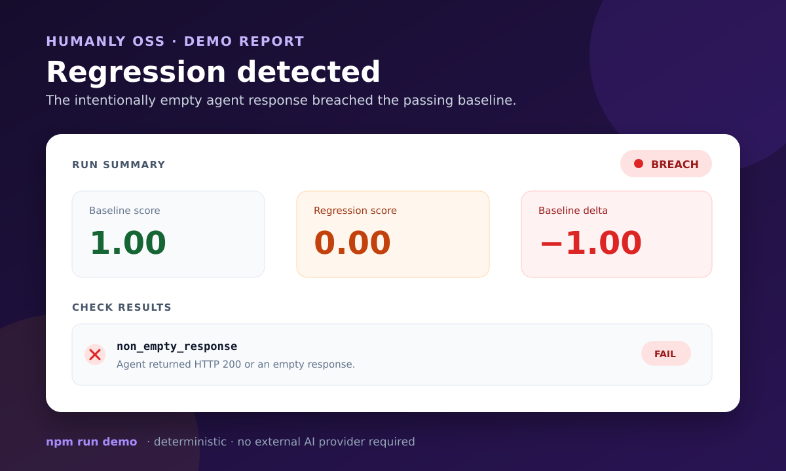
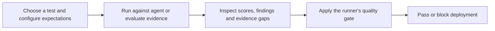

# Humanly

### Evaluate AI agents before release—and catch regressions in CI

Humanly OSS tests conversational behaviour, evidence-backed workflows and RAG
answers. Use authored turns or adaptive synthetic users, inspect the findings,
and block releases when your configured quality gate fails.

[Choose a test](docs/choose-your-test.md) · [Quick Start](#quick-start) · [Documentation](docs/introduction.mdx) · [Hosted Studio](https://humanly.ai)

[](LICENSE)
[](package.json)



_An actual report produced by `npm run demo`: the baseline passed, the
intentionally empty agent response failed, and the regression gate detected the
drop._

## How it works



OSS runs independently of Studio. Model-based evaluation uses your own provider;
deterministic workflow checks need no judge. Studio adds hosted visual creation,
managed execution and its broader evaluation catalog. Neither route guarantees
production safety or identical scores.

## Choose what to test

| Your question | OSS runner | What you configure | Model provider? |
| --- | --- | --- | --- |
| Does the agent handle a realistic conversation well? | [Conversation](docs/conversational-testing.md), scripted or synthetic | User turns or persona; scenario; weighted criteria; thresholds and budgets | Yes: judge in both modes, simulator in synthetic mode |
| Did it act on the right target, obtain approval and report tool outcomes honestly? | [Workflow L1–L5](docs/workflow-evaluation.md) | Scripted turns or captured runtime evidence; explicit action/state expectations | No judge; your agent may still use models |
| Are answers grounded, correct and supported by retrieved evidence? | [RAG](docs/rag-evaluation.md) | Questions, reference answers/facts, retrieval evidence and thresholds | Yes for semantic judging |
| Is the connector reachable and returning text? | Legacy single-turn suites | Endpoint, goal, count and optional baseline | No judge; this is only a smoke test |

Conversational and workflow checks can be combined with `workflowChecks`.
RAG currently evaluates independent questions, not multi-turn conversational RAG.
See [the selection guide](docs/choose-your-test.md) for commands, setup and CI rules.

## Two ways to use Humanly

| Humanly OSS | Humanly Studio |
| --- | --- |
| For developers and engineering teams | For product, design, QA, and engineering teams |
| Self-hosted with Docker and PostgreSQL | Hosted at [humanly.ai](https://humanly.ai) |
| REST API plus TypeScript SDK and CLI source | Visual, no-code test creation and analysis |
| Scripted and synthetic-user conversations, plus L1–L5 runtime checks | Managed synthetic-user runs with saved personas and the broader evaluation catalog |
| Standalone RAG evaluation with your own judge provider | Managed RAG evaluation and visual reports |
| AGPL-3.0-or-later | Proprietary hosted product |

## Why Humanly

- **Synthetic-user testing:** Humanly Studio exercises LLM-generated multi-turn
  behaviour instead of relying only on isolated prompts. That kind of synthetic
  conversation is also available through the standalone OSS
  [conversation runner](docs/conversational-testing.md), with a configured
  persona, scenario, weighted criteria and provider. Existing legacy `/v1/runs`
  suites still perform one-turn connector evaluations; use the explicit
  conversation or workflow runner for multi-turn testing.
- **Behaviour and outcome evaluation:** the OSS conversation runner evaluates
  configured rubrics and required thresholds. Legacy suites retain their
  deterministic non-empty-response check. Studio has a broader criteria catalog;
  identical scoring or automatic criteria interchange is not promised.
- **Regression gates:** legacy suites support stored score baselines; the newer
  runners use their own configured thresholds and evidence gates.
- **CI/CD:** conversational, workflow and RAG CLI failures or inconclusive
  results block CI. `baselineBreach` belongs to legacy suite reports, not every runner.

## Quick start

**Fastest provider-free evaluation:** with Node.js 20+, clone this repository,
run `npm ci`, then follow the [fixed/faulty workflow example](docs/workflow-evaluation.md#quick-start--no-paid-providers).
It evaluates supplied evidence without Docker, PostgreSQL or provider keys;
it is not a live-agent test.

**For synthetic-user conversations:** follow the
[conversation setup](docs/conversational-testing.md#standalone-oss-setup).
CLI execution needs Node.js and a configured judge/simulator provider, not the API server.

**For the persistent API:** use the Docker setup below.

### Prerequisites

- Docker Engine
- Docker Compose v2
- A free local port (5000 by default)
- Node.js 20+ and npm for host-side demo, CLI and SDK commands below

No model-provider key, Studio account, or session secret is required for the
default smoke checks or deterministic L1–L5 workflows. Conversational grading
(including scripted conversations) and semantic RAG use your configured provider.
See [conversation setup](docs/conversational-testing.md) and [RAG setup](docs/rag-evaluation.md).

```bash
git clone https://github.com/somnath-biswas-github/humanly.git
cd humanly
cp .env.example .env

# Put a long random value in HUMANLY_API_KEY.
# This command generates one on systems with OpenSSL:
openssl rand -hex 32

docker compose up --build
```

The first start builds the image, starts PostgreSQL, applies the versioned
migration, and then starts the API. Wait for `Humanly OSS listening`, then:

```bash
curl http://localhost:5000/health
```

Expected:

```json
{
  "status": "ok",
  "ready": true,
  "version": "0.1.0"
}
```

The exact first-start time depends on network and Docker cache state.
Local verification is not a claim that a GitHub Actions workflow has passed.

## Run the included evaluation

The demo starts the same Docker stack plus a deterministic local HTTP agent. It
creates a passing run, establishes that run as a baseline, then runs an
intentional empty-response regression.

Set `HUMANLY_API_KEY` in `.env`, then run:

```bash
npm run demo
```

Successful output includes:

```text
Baseline score: 1
Regression score: 0
Baseline breached: true
Failed check: non_empty_response
Report: demo-output/report.json
```

This is a deliberate failed quality check; the demo command itself succeeds only
when Humanly detects it correctly. See the
[example report](examples/example-evaluation-report.json).

## Connect your agent

Your agent exposes an HTTP endpoint. Humanly sends:

```json
{
  "message": "Say hello to the customer.",
  "conversationId": "run_xxx_conversation_1",
  "history": []
}
```

Return JSON with `reply`, `response`, `message`, `content`, `text`, `answer`,
or `output`, or return non-empty plain text. The first string field in that
order wins; a blank string fails even if a later field contains text:

```json
{
  "response": "Hello! How can I help?"
}
```

The default suite check only verifies HTTP success and non-empty response text.
A pass does **not** establish factual correctness, groundedness, retrieval recall,
or answer completeness. Use the separate [RAG evaluator](docs/rag-evaluation.md)
for those checks.

Create the connector through `POST /v1/connectors`:

```bash
curl -X POST http://localhost:5000/v1/connectors \
  -H "Authorization: Bearer $HUMANLY_API_KEY" \
  -H "Content-Type: application/json" \
  -d '{
    "name": "My agent",
    "agentId": "agent_xxx",
    "endpointUrl": "https://agent.example.com/chat"
  }'
```

See the [AgentConnector guide](docs/guides/agent-connector-setup.mdx) for
authentication and private-network safeguards.

## Example evaluation result

Reports contain the score, individual checks, the request and response, and
baseline comparison:

```json
{
  "status": "completed",
  "overallScore": 0,
  "passRate": 0,
  "baselineBreach": true,
  "baselineDelta": -1,
  "conversations": [{
    "passed": false,
    "checkScores": [{
      "checkName": "non_empty_response",
      "score": 0,
      "passed": false
    }]
  }]
}
```

## TypeScript SDK

`@humanlyai/sdk` is the canonical package name. The currently published npm
version (`0.1.0`) targets the hosted API and is not the SDK exercised by this
self-hosted release. Until the OSS-compatible prerelease is published, build and
install the checked-in source:

```bash
(cd packages/sdk && npm ci && npm run build && npm pack --pack-destination ../..)
npm install ./humanlyai-sdk-0.1.1-oss.0.tgz
```

```ts
import { HumanlyClient } from "@humanlyai/sdk";

const humanly = new HumanlyClient({
  apiKey: process.env.HUMANLY_API_KEY!,
  baseUrl: "http://localhost:5000",
});

const run = await humanly.triggerRun({ suiteId: "suite_xxx" });
const report = await humanly.waitForRun(run.id);

if (report.baselineBreach) process.exit(1);
```

The CLI in [`packages/cli`](packages/cli) is also source-only in v0.1 and is
**not** advertised as an installable npm package.

## CI/CD integration

The example below applies to **legacy single-turn suites**. For the newer
runners, use their CLI exit status and report gate; see the
[CI/CD guide](docs/guides/ci-cd.mdx). Do not look for `baselineBreach` in
conversation, workflow or RAG reports.

Build the repository CLI, then use it as a deployment gate:

```bash
npm --prefix packages/cli ci
npm --prefix packages/cli run build

HUMANLY_BASE_URL=http://localhost:5000 \
HUMANLY_API_KEY="$HUMANLY_API_KEY" \
node packages/cli/dist/index.cjs run \
  --suite "$SUITE_ID" \
  --baseline "$BASELINE_ID" \
  --out humanly-results
```

The command exits non-zero when the report contains a baseline breach. See the
[CI/CD guide](docs/guides/ci-cd.mdx).

## Capabilities

Available in OSS v0.1:

- API-key authenticated `/v1` REST API
- Agents, connectors, suites, runs, reports, personas, and baselines
- HTTP AgentConnector with bearer and API-key forwarding
- Private, loopback, link-local, and reserved destination blocking by default
- One-turn deterministic non-empty-response evaluation (existing default)
- Scripted or adaptive synthetic-user conversational evaluation with weighted
  criteria, required thresholds, execution budgets, judge-only replay and script export
- Scripted multi-turn workflow evaluation: L1 policy/action, L2 approval,
  L3 state/target, L4 structured tool-outcome consistency and L5 progress/termination.
  See [workflow evaluation](docs/workflow-evaluation.md) for Studio/OSS parity,
  runtime evidence, runnable faulty/fixed fixtures and quality gates.
- Standalone semantic RAG evaluation through API and CLI, using your own
  OpenAI-compatible judge provider; no Studio account required.
  See [RAG evaluation](docs/rag-evaluation.md) for setup, evidence and CI gates.
- PostgreSQL persistence and automatic versioned migrations
- Docker readiness health check
- OSS-compatible TypeScript SDK, CLI, and Python SDK source

Not included in OSS v0.1:

- The Humanly Studio web interface
- Studio’s evaluation-check catalog
- Studio's general LLM trace-scoring catalog, webhooks,
  teams, or billing. Structured workflow event evaluation is supported separately.

## Documentation

- [Quick start](docs/quickstart.mdx)
- [Choose your test](docs/choose-your-test.md)
- [Scripted and synthetic-user conversations](docs/conversational-testing.md)
- [Evidence-backed workflow evaluation](docs/workflow-evaluation.md)
- [Self-hosting](docs/self-hosting.mdx)
- [AgentConnector guide](docs/guides/agent-connector-setup.mdx)
- [Standalone RAG evaluation](docs/rag-evaluation.md)
- [First test run](docs/guides/first-test-run.mdx)
- [Regression baselines](docs/guides/regression-baselines.mdx)
- [REST API](sdk/api/overview.mdx)
- [TypeScript SDK](sdk/typescript/overview.mdx)
- [Roadmap and issue candidates](docs/ROADMAP.md)

Run `npm run check:links` to validate repository-internal documentation links.

## Contributing

See [CONTRIBUTING.md](CONTRIBUTING.md), the
[Code of Conduct](CODE_OF_CONDUCT.md), and the prepared
[good first issue candidates](docs/ROADMAP.md#good-first-issue-candidates).
Security issues must follow [SECURITY.md](SECURITY.md), not a public issue.

## Project status

**Current maturity: beta / initial `0.1.0` release candidate.**

Stable enough for the first release:

- Clean Docker build and PostgreSQL startup
- Automatic migration and readiness health check
- Versioned API and deterministic starter evaluation
- Baseline comparison and JSON reports

Beta:

- TypeScript, Python, and CLI client surfaces
- Operational hardening beyond a single-node deployment
- Conversational and semantic judges: automated fixtures do not establish
  real-model calibration or freedom from false passes/failures

Planned:

- More deterministic checks
- Unified configuration/report interchange across runners (multi-turn execution is already available)
- JUnit export
- OpenAPI documentation
- Scoped API-key management

See [CHANGELOG.md](CHANGELOG.md) and the
[issue-ready roadmap](docs/ROADMAP.md).

## Licence

Humanly OSS is licensed under [AGPL-3.0-or-later](LICENSE). Humanly Studio is
proprietary and is not included in this repository.

If this release is useful, consider
[starring the repository](https://github.com/somnath-biswas-github/humanly).